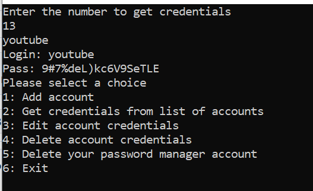

## Overview

This password manager was a project for ICs 427 Software Quality Assurance. Our groups had to come up with a project that incorporated a database and securely stored and retrieved data. My group came up with a program containing all the basic functions that password managers have. It uses an interface designed by another group member while I worked on the java backbone of the program.

## Contributions

In working on the program, I contributed the actual sections of code that would generate, store, and encrypt the passwords as well as interact with and generate a database for use with the program. I also did the research into the encryption as well as the implementation of the various packages required by the program. I also created a user-based system that allowed multiple users to store their passwords and keep their information separated from other users.

## How it worked

After running the file using the -c flag, the program runs an initial startup if it does not detect an existing database, creating one with the proper fields and information. It will then prompt you to make an account using a username and password. Once complete, it generates a key that will be used to help encrypt your data that it stores using your account. Since it is the only way to properly retrieve the data you must make sure to keep this file in a safe place when not using the program as anyone can encrypt your data if they can get into your account and your key is still in the folder.

Once complete, you can start using the program, generating passwords and storing them in the database.

It will generate, encrypt, and store that information using the provided key. Then retrieve and decrypt when retrieving that information.

It also has multiple user profiles, so more than one user can use the same program at the same computer with the same database and still keep their information safe from each other.

## What I learned

The assignment was helpful in learning how to incorporate other packages and code created by others as well as the effort that goes into planning, developing, and safeguarding your projects. It also helped show that the completion of a project is not the end and proper maintenance and upkeep as well as a thorough plan in case things do not go as planned are helpful in creating a safe product. It was also my first time dealing with encryption and was helpful in understanding what options and possibilities there are in trying to develop with security in mind.

## With more time...

If I were to work on this project again, I'd want to spend more time adding user-friendly features like variable lengths for password generation, password recovery techniques, as well as a graphical user interface.

## Links to the program

If you'd like to try out the site for yourself, you can find a link to our project [here](https://github.com/courtney-j-davis/ICS427-Project) with a link to its wiki [here](https://github.com/courtney-j-davis/ICS427-Project/wiki).
