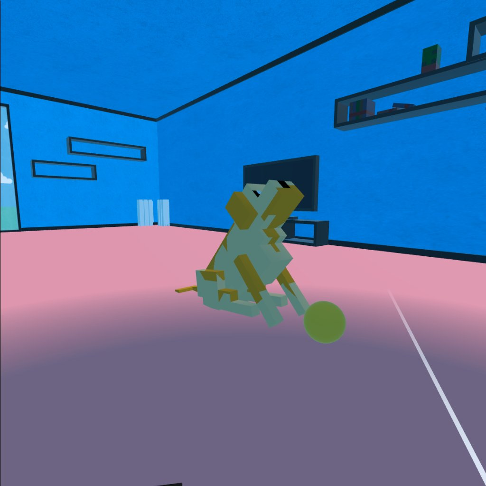
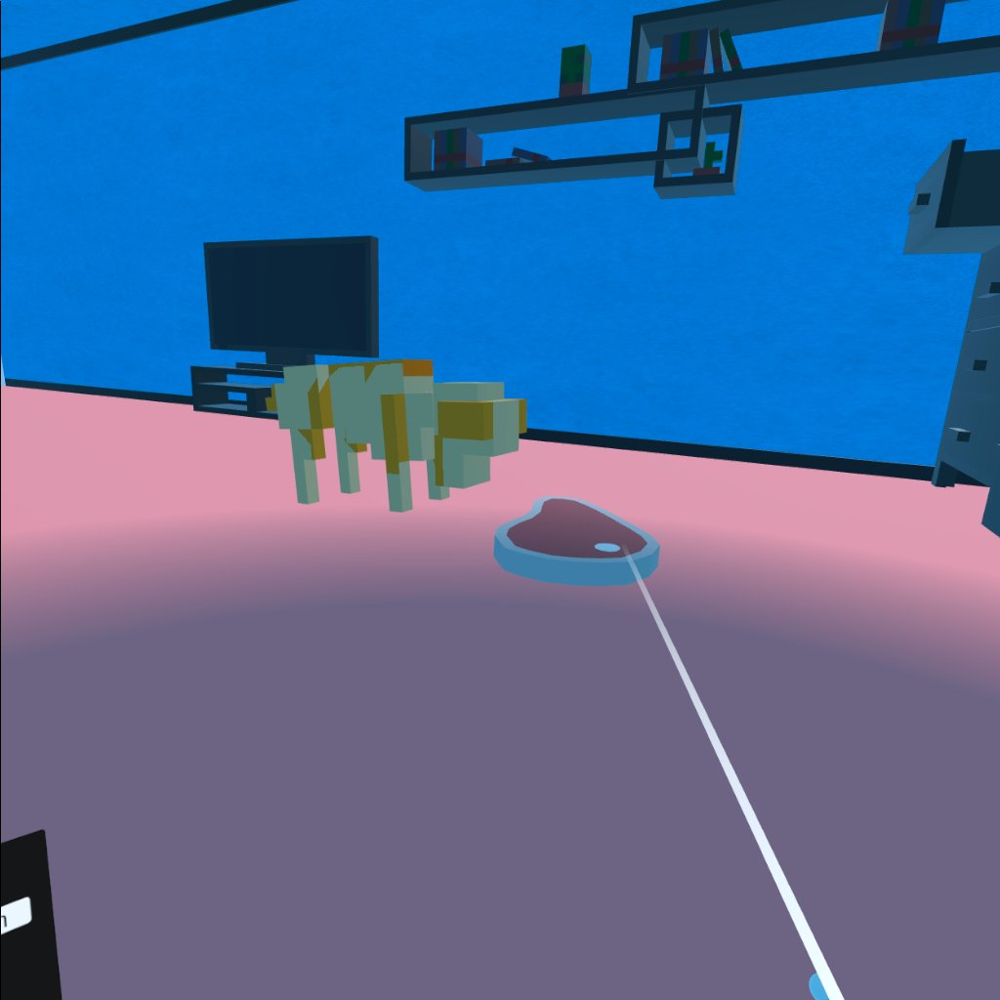
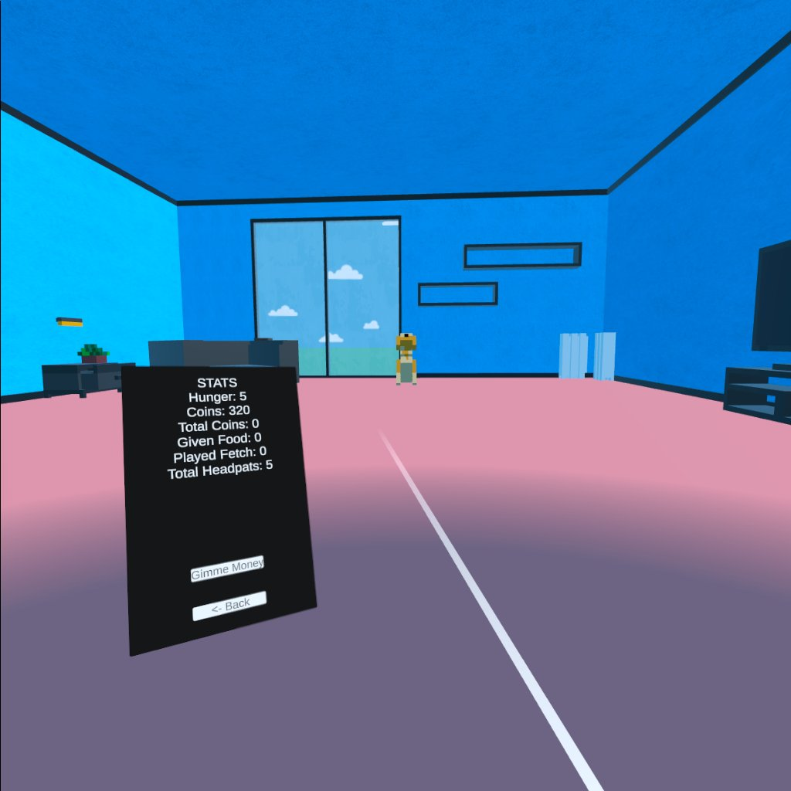

## Overview

This was the final project of my ICS 486 class, Virtual & Augmented Reality Programming. We had to implement spatial sound (distance/location based sound effects) and interaction with the environment in some way using the VR capabilities within Unity. I designed this pet simulator as a way to interact with your virtual dog, playing games like fetch and feeding them to earn coins you could use for home decorations and other features.

## What I learned
This project taught me a lot about how to create 3d as well as VR experiences in Unity. While I had some experience in Unity before this having taken a Game Design course, it was 2D so some of the skills did not translate over as easily. It also helped test my abilities in mapping out a plan beforehand, so that I could meet the deadlines and turn in a working project on time. As I was working on this project myself this time it also tested my skills in multitasking and implementing all parts including the programming, visuals, and audio while ensuring they all worked together and were as user-friendly as possible.

## With More Time...
If I had more time before the project was due, I had intended to implement more features within the game. Some of which are present in the current build of the game, just not selectable. I wanted to expand on the interactivity with the dog, having more games like tug of war or even tic tac toe that you could buy from the shop. Along with this I wanted to have more aesthetic changes you could purchase such as new dog breeds and more locations with more buyable furniture for each place. I'd also want to upgrade the user interface and make it a bit more visually appealing and easy to use.

## Link to the game

The link to the github for the project is located [here](https://github.com/mhkfchun/petsim) and the apk to play the game can be located [here](https://github.com/mhkfchun/petsim/releases/tag/v0.1.0-beta)
